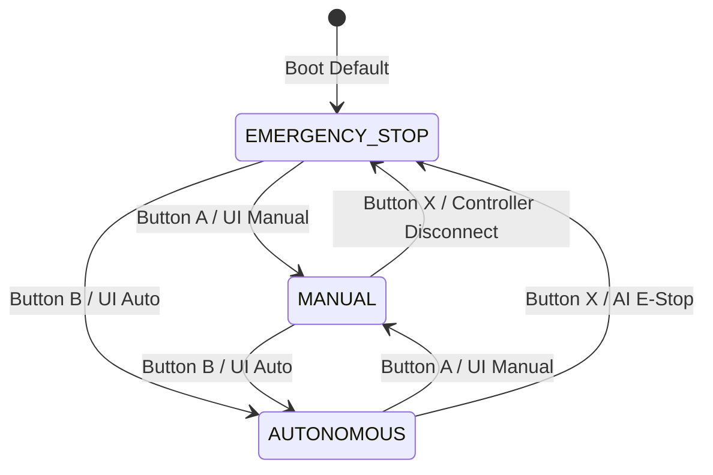

# 08 - Centralized Control Mode Manager Specification

---

## 1. Purpose
This document specifies the software architecture, state machine, atomic transition invariants, and safety arbitration handled by the `ControlModeManager` class in the Android application.

---

## 2. Requirements
- Kotlin Android codebase (`com.autonomous.aicontrol.controller.ControlModeManager`).
- Guaranteed single-owner actuation (only ONE source may actuate motors at any moment).

---

## 3. State Machine Model

---

## 4. Atomic Transition Protocol
When changing modes (e.g., from `MANUAL` to `AUTONOMOUS` or vice-versa), the following 7-step sequence is executed synchronously:
1. **Zero Velocity Dispatch:** Instantly sends `CMD:DRIVE:0:0` and `CMD:STOP:0:0` to halt motors.
2. **Pending Command Cancellation:** Discards any pending IO transmission coroutines.
3. **Controller Input Flush:** Clears stick coordinates, smoothed variables, and rate limiter memory in `DifferentialDriveController`.
4. **AI Decision Flush:** Resets consecutive detection counters and candidate trackers in `DecisionEngine`.
5. **Mode Variable Assignment:** Transitions `currentMode` under `@Synchronized` lock.
6. **Source Validation:** Validates the incoming source (e.g., confirms camera pipeline is live before entering `AUTONOMOUS`).
7. **Input Arming:** Enables command dispatching for the newly active subsystem.

---

## 5. Invariants & Failsafes
- **No Concurrent Control:** Manual direct drive and Autonomous action commands can **never** execute simultaneously.
- **Controller Disconnect Trap:** If the Cosmic Byte Ares Pro disconnects while in `MANUAL` mode:
  - System immediately triggers `EMERGENCY_STOP`.
  - System **never** auto-switches to `AUTONOMOUS` mode (prevents unexpected vehicle runaway).
- **Sticky E-Stop:** Once Emergency Stop is engaged, movement is locked until the user explicitly presses `A` or `B` to resume.

---

## 6. Verification Checklist
- [ ] System initializes in `EMERGENCY_STOP` on cold boot.
- [ ] Switching between Manual and Auto halts motors instantly during transition.
- [ ] Gamepad disconnect in Manual mode locks vehicle in Emergency Stop.
