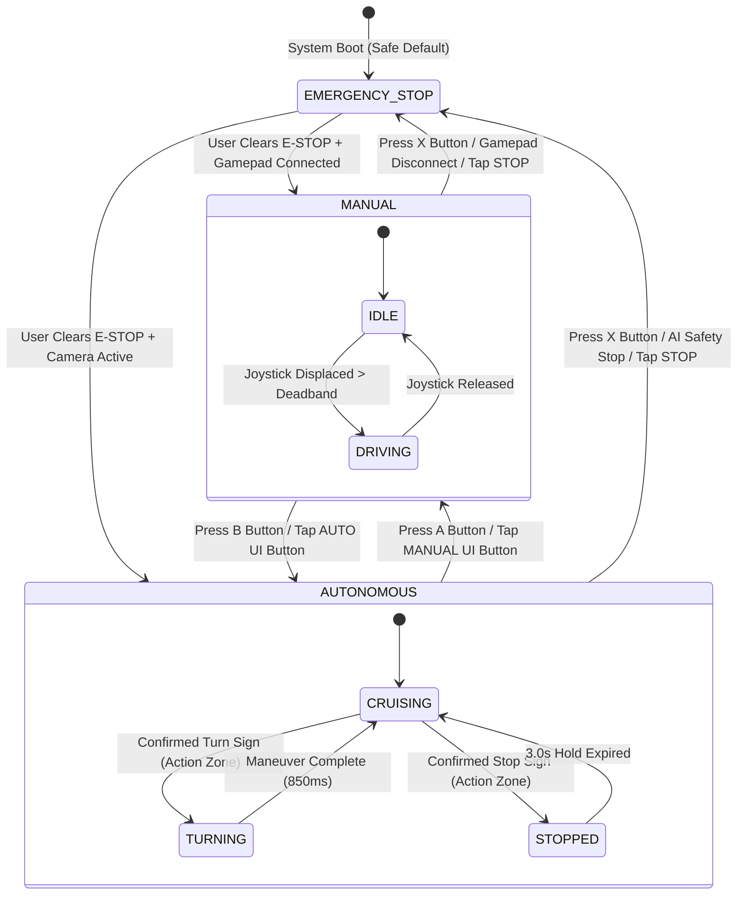

# 📋 Dual-Mode Update Audit & Architecture Specification
### *Integration of Cosmic Byte Ares Pro Gamepad with Autonomous AI Vision Car*

> **Document ID:** `DUAL_MODE_UPDATE_AUDIT.md`  
> **Date:** 2026-11-06  
> **Author:** Senior Embedded & Android AI Systems Engineer  
> **Project Target:** AI Autonomous Traffic Sign Car (Rebuilt v2.0 -> v2.1 Dual-Mode)  
> **Status:** APPROVED & AUDITED  

---

## 1. Executive Summary

This engineering audit specifies the architecture, module modifications, new components, safety state machines, and verification plan for adding **Manual Wireless Controller (Cosmic Byte Ares Pro) + Autonomous Dual-Mode Driving** to the existing autonomous vehicle.

### Core Architecture Shift:
- **Baseline (v2.0):**  
  `Android Smartphone CameraX` ➔ `YOLOv8n Neural Engine` ➔ `DecisionEngine` ➔ `UdpVehicleClient` ➔ `Wi-Fi SoftAP (Port 8888)` ➔ `ESP8266 NodeMCU` ➔ `TB6612FNG` ➔ `TT DC Motors`
- **Upgraded Dual-Mode (v2.1):**  
  ```text
  ┌─────────────────────────────────────┐
  │   Cosmic Byte Ares Pro Gamepad      │
  │   (Bluetooth HID Controller)        │
  └──────────────────┬──────────────────┘
                     │ Bluetooth HID Native Events (MotionEvent / KeyEvent)
                     ▼
  ┌────────────────────────────────────────────────────────────────────────┐
  │                   ANDROID SMARTPHONE (REDMI)                           │
  │                                                                        │
  │   ┌───────────────────────────┐      ┌─────────────────────────────┐   │
  │   │ AresProController         │      │ CameraX + YOLOv8n Engine    │   │
  │   │ • Native Axis & Button API│      │ • 1080p Stream @ 30 FPS     │   │
  │   │ • Diagnostics & Deadband  │      │ • 6 Traffic Sign Classes    │   │
  │   └─────────────┬─────────────┘      └──────────────┬──────────────┘   │
  │                 │                                   │                  │
  │                 ▼                                   ▼                  │
  │   ┌───────────────────────────┐      ┌─────────────────────────────┐   │
  │   │ DifferentialDriveController│     │ DecisionEngine              │   │
  │   │ • Smooth Joystick Math    │      │ • Temporal Debounce         │   │
  │   │ • Accel / Decel Ramping   │      │ • Spatial Distance Zones    │   │
  │   └─────────────┬─────────────┘      └──────────────┬──────────────┘   │
  │                 │                                   │                  │
  │                 └──────────────┐     ┌──────────────┘                  │
  │                                ▼     ▼                                 │
  │                    ┌───────────────────────────────┐                   │
  │                    │      ControlModeManager       │                   │
  │                    │  • State Machine:             │                   │
  │                    │    [MANUAL | AUTO | E_STOP]   │                   │
  │                    │  • Single Active Source Lock  │                   │
  │                    │  • Failsafe Disconnect Trap   │                   │
  │                    └───────────────┬───────────────┘                   │
  │                                    │ Safe Command Dispatch             │
  │                                    ▼                                   │
  │                    ┌───────────────────────────────┐                   │
  │                    │       UdpVehicleClient        │                   │
  │                    │  • Sub-3ms UDP Socket         │                   │
  │                    │  • Action & DRIVE Protocol    │                   │
  │                    └───────────────┬───────────────┘                   │
  └────────────────────────────────────┼───────────────────────────────────┘
                                       │ High-Speed UDP Datagrams (Port 8888)
                                       ▼
  ┌────────────────────────────────────────────────────────────────────────┐
  │                   EMBEDDED ACTUATOR (NodeMCU ESP8266)                  │
  │  • Dual-Protocol Parser: CMD:<ACTION>:... & CMD:DRIVE:<left>:<right>:.. │
  │  • Independent Motor A & B Direct PWM Mapping                          │
  │  • 1000ms Hardware Communication Watchdog Fail-Safe                    │
  │  • Instant UDP Acknowledgement (ACK:ACTION:SEQ:RSSI)                   │
  └────────────────────────────────────┬───────────────────────────────────┘
                                       │ Dual H-Bridge PWM & Phase Control
                                       ▼
  ┌────────────────────────────────────────────────────────────────────────┐
  │                   PROPULSION HARDWARE                                  │
  │  • TB6612FNG Dual MOSFET Driver                                        │
  │  • Left & Right TT DC Gear Motors (1:48 Differential Drive)            │
  └────────────────────────────────────────────────────────────────────────┘
  ```

---

## 2. Existing Baseline Inventory & Verified Functionality

| Subsystem | Existing Implementation | Verification Status | Dual-Mode Integration Requirement |
| :--- | :--- | :--- | :--- |
| **Android App Core** | `MainActivity.kt` (CameraX preview, HUD binding) | **Functional** | Add Gamepad event handlers (`onGenericMotionEvent`, `onKeyDown`, `onKeyUp`, input device listeners), diagnostic overlay, mode buttons. |
| **AI Vision Engine** | `YoloDetector.kt` (TFLite/ONNX, 6 traffic signs) | **100% Functional** | **Preserve untouched.** Only dispatches movement commands when `ControlModeManager` is in `AUTONOMOUS` mode. |
| **Decision Engine** | `DecisionEngine.kt` (Temporal debounce, state machine) | **100% Functional** | **Preserve untouched.** Outputs evaluated decisions; commands gated by `ControlModeManager`. |
| **Wireless Protocol** | `UdpVehicleClient.kt` (`CMD:ACTION:speed:trim:seq`) | **Functional** | Add `sendDriveCommand(leftPwm, rightPwm)` for manual proportional differential drive while retaining backwards-compatible action commands. |
| **Cockpit HUD Canvas** | `OverlayView.kt` (Sci-Fi bounding box badges) | **Functional** | Extend to display controller telemetry (stick vectors, active buttons, motor output bars). |
| **ESP8266 Firmware** | `main.cpp` & `esp8266_firmware.ino` | **Functional** | Add `CMD:DRIVE:<leftPwm>:<rightPwm>:<seq>` parser for direct analog motor steering alongside standard `CMD:FORWARD/STOP/etc.` |
| **Motor Driver Logic** | `motor_driver.h` (`applyDirectMotors`) | **Functional** | Expose public `driveDirect(int leftPwm, int rightPwm)` with smooth acceleration ramping. |
| **Safety Watchdog** | `watchdog.h` (1000ms timeout) | **Functional** | **Preserve.** Failsafe stops car automatically if UDP datagrams pause. |

---

## 3. Files Requiring Modification

1. **`03_ANDROID_APP/app/src/main/java/com/autonomous/aicontrol/MainActivity.kt`**
   - Register `InputManager.InputDeviceListener` to detect gamepad connection/disconnection.
   - Override `dispatchGenericMotionEvent` and `dispatchKeyEvent` for gamepad events.
   - Bind `ControlModeManager`, `AresProController`, and `DifferentialDriveController`.
   - Update UI dashboard to display controller status, motor speeds, and diagnostic telemetry.
2. **`03_ANDROID_APP/app/src/main/java/com/autonomous/aicontrol/network/UdpVehicleClient.kt`**
   - Add `sendDriveCommand(leftPwm: Int, rightPwm: Int)` generating `CMD:DRIVE:<leftPwm>:<rightPwm>:<seq>\n`.
   - Retain existing `sendCommand(action, speed, trim)` for autonomous maneuvers.
3. **`03_ANDROID_APP/app/src/main/res/layout/activity_main.xml`**
   - Add Gamepad status bar: Controller Name, Connection badge (GREEN/RED), Speed Profile badge.
   - Add Diagnostic panel: Left Stick (X, Y), Right Stick (X, Y), Triggers, Buttons.
   - Add Left and Right Motor Speed indicator gauges.
4. **`04_ESP8266_FIRMWARE/include/motor_driver.h`**
   - Add `driveDirect(int leftPwm, int rightPwm)` with bidirectional control (-1023 to +1023).
5. **`04_ESP8266_FIRMWARE/include/udp_protocol.h`**
   - Add support for `CMD:DRIVE:<leftPwm>:<rightPwm>:<seq>`.
6. **`04_ESP8266_FIRMWARE/src/main.cpp` & `esp8266_firmware.ino`**
   - Process `DRIVE` command and feed watchdog timer.

---

## 4. New Files Required

| New File Path | Responsibility & Key Methods |
| :--- | :--- |
| `03_ANDROID_APP/.../controller/AresProController.kt` | Native Android `InputDevice` listener, axis mapping, deadband filtering, button decoding, calibration profile. |
| `03_ANDROID_APP/.../controller/DifferentialDriveController.kt` | Differential steering algorithm, exponential smoothing, acceleration/deceleration ramping, speed profile clamping. |
| `03_ANDROID_APP/.../controller/ControlModeManager.kt` | Strict state machine (`MANUAL`, `AUTONOMOUS`, `EMERGENCY_STOP`), atomic source transition, failsafe disconnect stop. |
| `03_ANDROID_APP/.../controller/GamepadDiagnosticData.kt` | Live diagnostic data holder for HUD visualization. |
| `06_TESTING/controller_tests/test_differential_drive.py` | Automated unit test suite verifying joystick differential math, smoothing, ramping, deadband. |
| `06_TESTING/controller_tests/test_mode_manager.py` | Automated unit test verifying mode state transitions, priority hierarchy, disconnect failsafe. |
| `06_TESTING/communication_tests/test_udp_drive_packet.py` | Automated unit test verifying new `CMD:DRIVE` serialization and deserialization. |
| `01_DOCUMENTATION/dual_mode/*.md` (14 Guides) | Comprehensive 14-part dual mode operational documentation suite. |

---

## 5. Compatibility & Hardware Analysis: Cosmic Byte Ares Pro

1. **Bluetooth Profile:**
   - The Cosmic Byte Ares Pro operates using Bluetooth 5.0 in standard HID Gamepad mode.
   - On Android, it connects as a standard `InputDevice` with sources:
     `InputDevice.SOURCE_GAMEPAD | InputDevice.SOURCE_JOYSTICK`.
2. **Axis Identifiers on Android:**
   - Left Stick X: `MotionEvent.AXIS_X` (-1.0 = Full Left, +1.0 = Full Right).
   - Left Stick Y: `MotionEvent.AXIS_Y` (-1.0 = Full Forward/Up, +1.0 = Full Backward/Down).
   - Right Stick X: `MotionEvent.AXIS_Z` or `AXIS_RX`.
   - Right Stick Y: `MotionEvent.AXIS_RZ` or `AXIS_RY`.
   - Left Trigger: `MotionEvent.AXIS_LTRIGGER` or `AXIS_BRAKE` (0.0 to 1.0).
   - Right Trigger: `MotionEvent.AXIS_RTRIGGER` or `AXIS_GAS` (0.0 to 1.0).
   - D-Pad: `MotionEvent.AXIS_HAT_X`, `MotionEvent.AXIS_HAT_Y`.
3. **Keycode Mappings:**
   - `A` = `KeyEvent.KEYCODE_BUTTON_A` (Code 96) ➔ Select Manual Mode.
   - `B` = `KeyEvent.KEYCODE_BUTTON_B` (Code 97) ➔ Select Autonomous Mode.
   - `X` = `KeyEvent.KEYCODE_BUTTON_X` (Code 99) ➔ Emergency STOP.
   - `Y` = `KeyEvent.KEYCODE_BUTTON_Y` (Code 100) ➔ Cycle Speed Profile (Eco ➔ Normal ➔ Sport).
   - `LB` = `KeyEvent.KEYCODE_BUTTON_L1` (Code 102) ➔ Speed Down.
   - `RB` = `KeyEvent.KEYCODE_BUTTON_R1` (Code 103) ➔ Speed Up.
4. **Android Pairing Mode:**
   - Hold `Home + A` or `Home + X` until the LED blinks rapidly to pair with Android Bluetooth.

---

## 6. Differential Drive Mathematical Model

Given:
- Normalized Left Stick Y: $Y \in [-1.0, 1.0]$ (Android reports $-1.0$ as UP/Forward)
- Normalized Left Stick X: $X \in [-1.0, 1.0]$ (+1.0 as Right)
- Deadband threshold: $\delta = 0.10$

1. **Deadband Filter:**
   $$Y_{filt} = \begin{cases} 0 & \text{if } |Y| < \delta \\ \text{sign}(Y) \cdot \frac{|Y| - \delta}{1 - \delta} & \text{otherwise} \end{cases}$$
   $$X_{filt} = \begin{cases} 0 & \text{if } |X| < \delta \\ \text{sign}(X) \cdot \frac{|X| - \delta}{1 - \delta} & \text{otherwise} \end{cases}$$

2. **Throttle & Steering Equations:**
   $$\text{throttle} = -Y_{filt} \quad (\text{so forward is positive } [+1.0])$$
   $$\text{steering} = X_{filt} \quad (\text{right turn is positive } [+1.0])$$

3. **Differential Motor Outputs:**
   $$M_{left} = \text{throttle} + \text{steering}$$
   $$M_{right} = \text{throttle} - \text{steering}$$

4. **Normalization & Speed Scaling:**
   $$\text{maxMag} = \max(1.0, |M_{left}|, |M_{right}|)$$
   $$M_{left, norm} = \frac{M_{left}}{\text{maxMag}} \cdot \text{maxProfilePwm}$$
   $$M_{right, norm} = \frac{M_{right}}{\text{maxMag}} \cdot \text{maxProfilePwm}$$

5. **Rate Limiter (Acceleration / Deceleration Ramp):**
   To prevent high inrush stall currents on TT motors:
   $$PWM_{t} = PWM_{t-1} + \text{clamp}(PWM_{target} - PWM_{t-1}, -\Delta_{decel}, +\Delta_{accel})$$
   - Safe zero-crossing: When reversing direction, speed ramps cleanly down to 0 before applying reverse phase.

---

## 7. Safety State Machine & Transitions



### Transition Invariants:
1. When transitioning between `MANUAL` and `AUTONOMOUS`, an explicit zero-velocity command (`CMD:STOP:0:0` or `CMD:DRIVE:0:0`) is dispatched immediately.
2. Stale controller inputs and pending AI decisions are purged before enabling the new control source.
3. If the Ares Pro controller disconnects while in `MANUAL` mode, the vehicle transitions directly to `EMERGENCY_STOP` and halts. It **never** auto-switches to `AUTONOMOUS`.

---

## 8. Step-by-Step Implementation Sequence

1. **Step 1:** Create pre-dual-mode backup (Completed).
2. **Step 2:** Implement `AresProController.kt`, `DifferentialDriveController.kt`, `ControlModeManager.kt`, and `GamepadDiagnosticData.kt`.
3. **Step 3:** Update `UdpVehicleClient.kt` to support `CMD:DRIVE:<leftPwm>:<rightPwm>:<seq>`.
4. **Step 4:** Upgrade `MainActivity.kt` with gamepad input listeners, lifecycle bindings, and telemetry loops.
5. **Step 5:** Enhance `activity_main.xml` layout with dual-mode controls, connection badges, and gamepad diagnostic HUD.
6. **Step 6:** Update ESP8266 firmware (`udp_protocol.h`, `motor_driver.h`, `main.cpp`, `esp8266_firmware.ino`) to support direct bidirectional motor drive.
7. **Step 7:** Write and execute automated Python test suites for differential drive math, mode transitions, and UDP protocol.
8. **Step 8:** Generate all 14 required Markdown documentation guides in `01_DOCUMENTATION/dual_mode/`.
9. **Step 9:** Generate `DUAL_MODE_FINAL_REPORT.md` and push all changes cleanly to GitHub.
