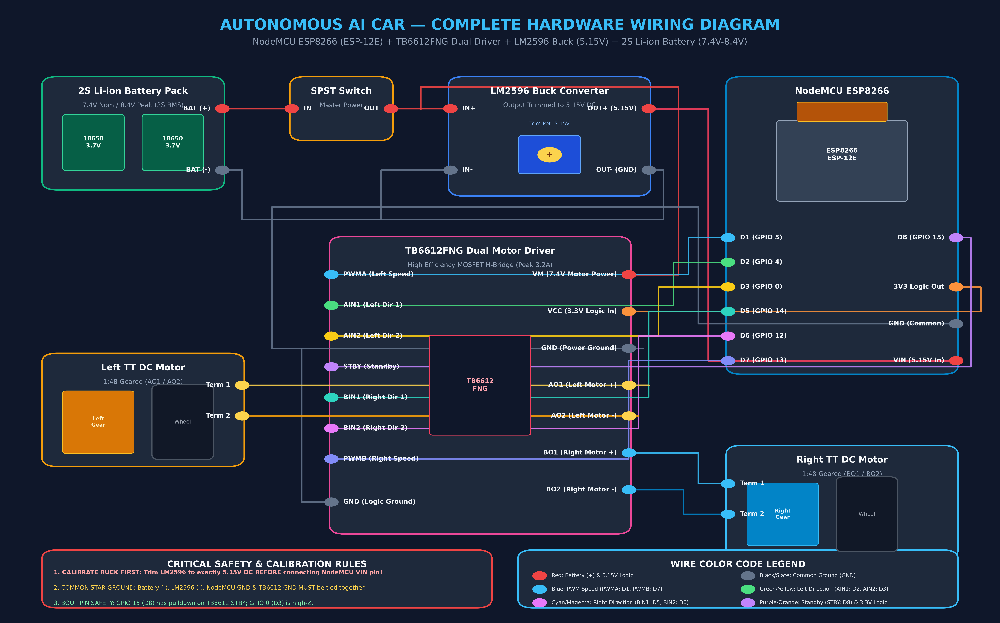

# 04. COMPLETE WIRING GUIDE & PIN ASSIGNMENT
**Autonomous AI Traffic Sign Detection Car**

---

## 1. Master Wiring Interconnect Table

| TB6612FNG Pin | NodeMCU Pin | GPIO | Function / Signal | Notes / Safety Constraints |
| :---: | :---: | :---: | :--- | :--- |
| **PWMA** | **D1** | GPIO 5 | Left Motor PWM Speed | Hardware PWM (0–1023), Safe general IO |
| **AIN1** | **D2** | GPIO 4 | Left Motor Direction 1 | General IO, Safe at boot |
| **AIN2** | **D3** | GPIO 0 | Left Motor Direction 2 | High-Z TB6612 input does not pull GPIO0 LOW |
| **BIN1** | **D5** | GPIO 14 | Right Motor Direction 1 | General IO, Safe at boot |
| **BIN2** | **D6** | GPIO 12 | Right Motor Direction 2 | General IO, Safe at boot |
| **PWMB** | **D7** | GPIO 13 | Right Motor PWM Speed | Hardware PWM (0–1023), Safe general IO |
| **STBY** | **D8** | GPIO 15 | Standby Enable | Active HIGH. Firmware holds LOW until init complete |
| **VCC** | **3V3** | 3.3V Rail | Logic Power Supply | Consumes $<5\text{ mA}$ |
| **GND** | **GND** | Ground Rail | Common Signal Ground | MUST be tied to Buck Converter & Battery GND |
| **VM** | **BAT+** | 7.4V–8.4V | Motor Drive High Voltage | Connects directly to fused Battery (+) switch output |
| **AO1 / AO2** | — | — | Left Motor Terminals | Connected to TT Motor A (reversing wires flips direction) |
| **BO1 / BO2** | — | — | Right Motor Terminals | Connected to TT Motor B (reversing wires flips direction) |

---

## 2. Power Supply & Buck Converter Connections

| Source | Connection | Destination | Purpose |
| :--- | :--- | :--- | :--- |
| **Battery (+) (7.4V–8.4V)** | Red Wire via SPST Switch | **LM2596 IN+** & **TB6612 VM** | Master power distribution |
| **Battery (-) (GND)** | Black Wire | **LM2596 IN-** & **Common GND** | System ground return |
| **LM2596 OUT+ (5.15V)** | Red Wire | **NodeMCU VIN pin** | Clean regulated 5.15V power to NodeMCU |
| **LM2596 OUT- (GND)** | Black Wire | **NodeMCU GND pin** | Clean regulated ground reference |

> [!CAUTION]
> **COMMON GROUND IS MANDATORY:** The battery ground, LM2596 ground, NodeMCU ground, and TB6612FNG ground MUST be connected together into a single star ground point. Failure to tie grounds together causes floating reference voltages, erratic motor twitching, and dropped Wi-Fi packets.

---

## 3. ESP8266 Boot Pin Constraints

The ESP8266 ESP-12E module samples specific GPIO pins at power-on reset to determine its boot mode:
1. **GPIO 15 (D8):** Must be **LOW** during boot. If pulled HIGH, the chip attempts to boot from an external SD card and hangs indefinitely. The TB6612FNG `STBY` pin has an internal pulldown resistor, making it safe to connect to D8.
2. **GPIO 0 (D3):** Must be **HIGH** during boot. If pulled LOW, the chip enters UART flashing mode and will not run stored firmware. The TB6612FNG `AIN2` input is a high-impedance CMOS gate that will not pull D3 down.
3. **GPIO 2 (D4):** Must be **HIGH** during boot. Tied to the onboard blue LED. Left unassigned to motor signals.
